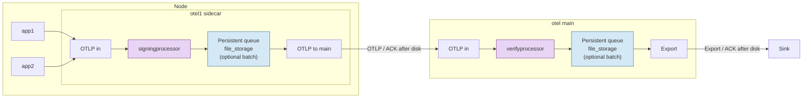

# Audit log delivery

Sign on the node sidecar, verify on otel main, persist exporter queues with `file_storage`.

The Astronomy Shop demo (Apeirora `auditlogreceiver`, in-memory persistence, `certificatelogverify`) is a separate schematic: [demo.md](demo.md) / [demo.html](demo.html).

Edit the Mermaid block below, then open the Markdown preview in Cursor (`Ctrl+Shift+V`) to view it. For a browser view, open `delivery.html`.



## Notes

- Memory queue is lost on crash; use `sending_queue` + `file_storage` (`fsync: true`).
- One queue is enough only on the sidecar if main acks after the sink accepts.
- At-least-once: a lost ack can cause a duplicate send.

## Batching (optional)

Do **not** add a separate `batch` processor for this pipeline. Prefer exporter-side batching on `sending_queue` (current collector direction; `batchprocessor` is being migrated away).

Sign/verify still run per incoming request from the previous hop. Batching only merges how many of those already-processed requests go out in one export call.

**Without batch** (fine to start): each accepted request is exported as its own send (still queued/persisted).

**With batch** (enable when you need fewer, larger OTLP calls):

```yaml
exporters:
  otlp:
    endpoint: otel-main:4317
    sending_queue:
      enabled: true
      storage: file_storage
      batch:
        flush_timeout: 200ms
        min_size: 8192   # items; tune for audit volume
        # max_size: 16384
```

Same `batch:` block can sit on otel main’s sink exporter.

Do not stack `batch` processor + `sending_queue.batch` — that double-batches. Use processor-side batch only if some later processor must see larger batches (not needed for sign → verify → sink).
