# Audit log delivery — Astronomy Shop demo

Checkout posts unsigned OTLP JSON. The Apeirora sidecar (`auditlogreceiver` + `signingprocessor`) signs it. The main collector (`certificatelogverify`) checks integrity, then the failover connector sends verified logs to Grafana. If that export fails, the same batch goes to the standby Grafana.

This is the path in `compose.audit.yaml`. The generic sign-on-sidecar / `file_storage` design is in [README.md](README.md).

Edit the Mermaid block below, then open the Markdown preview in Cursor (`Ctrl+Shift+V`). For a browser view, open `demo.html`.

```mermaid
flowchart LR
  subgraph SHOP["checkout"]
    FLAG["auditLogging flag"]
    APP["unsigned OTLP JSON<br/>no auditlog SDK"]
    FLAG -.-> APP
  end

  subgraph SIDE["otel-collector-audit-sidecar<br/>apeirora feat/otelauditcol"]
    RCV["auditlogreceiver<br/>:4320 /v1/audit<br/>response_mode: sync"]
    WAL["Persistence memory<br/>in-memory buffer<br/>circuit breaker<br/>open_behavior: accept"]
    SIGN[signingprocessor<br/>HMAC-SHA256]
    OUT["otlphttp → :4318<br/>retry on, queue off"]
    RCV --> SIGN --> OUT
    RCV --- WAL
  end

  subgraph MAIN["otel-collector<br/>apeirora certificatelogverify"]
    IN["OTLP HTTP :4318"]
    DROP["logs<br/>drop signed audit"]
    KEEP["logs/audit<br/>keep signed audit"]
    VERIFY["certificatelogverify<br/>sync, strict"]
    IN --> DROP
    IN --> KEEP --> VERIFY
  end

  FAILOVER["failover connector<br/>retry higher priority every 15s"]
  G1["Grafana<br/>localhost:8080/grafana"]
  G2["Grafana standby<br/>localhost:3001/grafana"]

  APP -->|"POST /v1/audit"| RCV
  OUT -->|"signed OTLP"| IN
  VERIFY --> FAILOVER
  FAILOVER -->|priority 1| G1
  FAILOVER -->|priority 2 when Grafana is down| G2

  classDef crypto fill:#e8d5f5,stroke:#7b2d8e
  classDef queue fill:#d5e8f5,stroke:#2d6a8e
  classDef recv fill:#fde8c8,stroke:#b86e00
  classDef fail fill:#dcfce7,stroke:#15803d
  class SIGN,VERIFY crypto
  class WAL queue
  class RCV recv
  class FAILOVER,G2 fail
```

## What this demo does

- Checkout builds an OTLP log record and `POST`s it to `http://otel-collector-audit-sidecar:4320/v1/audit`. The `auditLogging` feature flag gates emission. The app does not sign.
- `auditlogreceiver` (Apeirora `feat/otelauditcol`) accepts that path. Persistence is in memory on the receiver. After three downstream failures the circuit opens for 30s and `open_behavior: accept` still takes the record so it can be replayed. A restart drops that buffer.
- `signingprocessor` adds `audit.integrity.value` with HMAC-SHA256. The key file is `src/auditlog/keys/dev_hmac_key.txt`, mounted into the sidecar and the main collector.
- The sidecar exporter is `otlphttp` to `otel-collector:4318`. `sending_queue` is off. `retry_on_failure` covers a short window (max 8s). While main is down, unsent records stay in the receiver’s in-memory persistence.
- Main splits on `audit.integrity.value`. Ordinary logs stay on `logs` (`filter/drop_signed_audit`) and still export straight to the primary OpenSearch. Signed records take `logs/audit`: `filter/keep_signed_audit` → `certificatelogverify` (`mode: sync`, `failure_mode: strict`) → `failover/grafana`.
- `failover/grafana` tries `logs/audit/grafana` first. That exporter posts to `grafana:9200`, an nginx proxy in the main Grafana network namespace, which forwards to OpenSearch. `sending_queue` and `retry_on_failure` are off, so a failed export returns to the connector. The connector then sends that same batch to `logs/audit/grafana-standby` (`opensearch-standby`). Every 15s it tries the higher priority again.
- Stopping the `grafana` container removes `grafana:9200`. New verified audit logs show up in the standby Grafana. Other app logs do not move; they still use the direct OpenSearch exporter. After `docker start grafana`, run `docker restart grafana-primary-proxy` so the proxy attaches to the new network namespace.
- Primary Grafana Explore (OpenSearch): `attributes.verify_status:passed` or `_exists_:attributes.audit.action`. The same query on http://localhost:3001/grafana/ shows only the batches exported while the main Grafana path was down.

## Images

| Container | Apeirora ref | Components |
| --- | --- | --- |
| `otel-collector-audit-sidecar` | `feat/otelauditcol` + `signingprocessor` | `auditlogreceiver`, `signingprocessor`, in-memory persistence |
| `otel-collector` | `feat/certificatelogverifyprocessor` | `certificatelogverify`, `filter`, `failover` connector |
| `grafana-standby` | Grafana + OpenSearch standby | second sink for verified audit logs |
